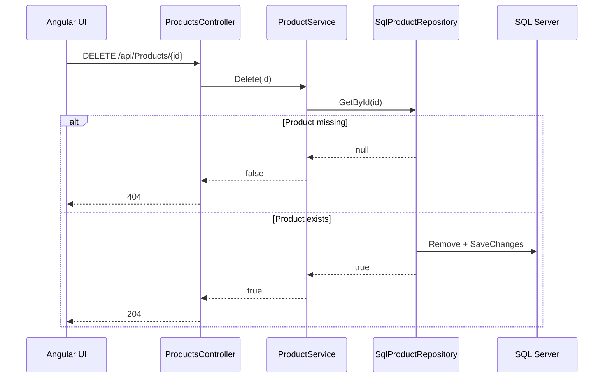

# Design: AIK-005 Delete a Product

## Approach

Use the existing synchronous Clean Architecture path. The repository receives the entity and removes it, the service reports whether deletion occurred, and the controller maps the result to 204 or 404. The Angular component confirms the action and delegates the HTTP call to ProductService.

## API Contract

```yaml
DELETE /api/Products/{id:int}
Responses:
  204: Product deleted
  404: Product not found
```

## File Impact

### Modify

- ProductManagement.Application/Interfaces/IProductRepository.cs
- ProductManagement.Application/Interfaces/IProductService.cs
- ProductManagement.Application/Services/ProductService.cs
- ProductManagement.Infrastructure/Repositories/SqlProductRepository.cs
- ProductManagement.API/Controllers/ProductsController.cs
- product-management-ui/src/app/services/product.ts
- product-management-ui/src/app/products/product-management/product-management.ts
- product-management-ui/src/app/products/product-management/product-management.html
- product-management-ui/src/app/products/product-management/product-management.css
- product-management-ui/src/app/app.spec.ts

### Create

- Angular unit tests if the installed Vitest builder supports focused component setup.
- No database migration or new project dependencies.

## Backend Sequence



## UI Behavior

1. ProductManagement prompts with the product name and stops on cancel.
2. Confirming starts deletion for that product only.
3. The Set-based deletingProductIds prevents duplicate requests.
4. On success, remove the product locally and refresh to recalculate totals from state.
5. On failure, preserve the row and set a useful error message.

## Test Design

- Angular test confirmation cancel prevents delete call.
- Angular test confirmed delete removes the product and updates totals.
- Angular test failed delete preserves the product and displays an error.
- Angular test duplicate delete is prevented while in progress.
- Backend test success maps to 204 and missing product maps to 404 if a test project is added.

## Review Checklist

- No direct DbContext access in controller.
- No in-memory repository registration.
- No migration for delete-only behavior.
- GET, POST, and PUT remain unchanged.
- Responsive action cell keeps Edit and Delete adjacent.

## Implementation Notes

The repository should call Remove(product) and SaveChanges. Service Delete returns false when GetById returns null, otherwise Repository.Delete returns true only when SaveChanges succeeds. The Angular service maps DELETE to void/Observable<void> without error transformation.
